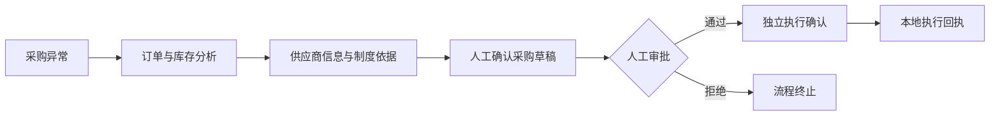

# ProcurePilot · 采购与供应链异常协同工作台

面向订单缺货、供应商延期等采购异常，将业务事实、制度依据、人工审批和流程恢复组织在同一工作台中，让每一项处理建议有依据、每一次操作可确认、每一个业务阶段可追踪。

[运行指南](docs/QUICKSTART.md) · [场景演示](docs/DEMO_SCRIPT.md) · [技术架构](docs/ARCHITECTURE.md)

## 业务场景

一张采购订单需要 100 件物料，当前可用库存为 22 件，供应商预计交付时间晚于需求日期 2 天。ProcurePilot 汇总订单、库存和供应商信息，计算 78 件缺口，检索适用采购制度，并将处理过程推进到人工审批。

审批通过后，仍需单独确认执行。系统保存本地执行回执；审批拒绝则终止流程。处理中断后，可根据已保存的业务状态继续处理。

## 核心能力

| 能力 | 工作台中的表现 |
| --- | --- |
| 采购异常分析 | 关联订单、库存与供应商报价，计算缺口和延期，展示业务事实与处理建议 |
| 制度依据追溯 | 检索采购制度，提供原文摘录、来源文件、章节、行号及内容摘要校验 |
| 人工审批协同 | 分离草稿确认、审批决定与执行确认，保留审批记录及本地执行回执 |
| 持久化与恢复 | 保存分析结果和业务阶段，通过创建幂等键与租约校验支持流程恢复 |
| 过程可观察 | 展示分析时间线、工具参数、调用结果、制度引用及运行报告 |
| 模型响应验收 | 离线回放合成案例，核对事实约束、引用标注与建议覆盖，展示可核对的逐项成绩 |

## 处理流程



分析环节通过 LangGraph 编排，业务读取通过 stdio MCP 完成。库存缺口、延期和金额由确定性代码计算；流程状态由应用层事务与 checkpoint 保存。

## 技术实现

- **后端**：Python、FastAPI、Pydantic、SQLAlchemy、Alembic；支持 MySQL 与 SQLite。
- **前端**：React、TypeScript、Ant Design，提供分析、工作流、审批、业务查询与制度证据分区。
- **分析与检索**：LangGraph 工作流、MCP 工具调用、TF-IDF 制度检索与可追溯引用。
- **可靠性**：业务阶段持久化、创建幂等、租约校验、事务回滚与重启恢复。

## 本地运行

```powershell
git clone https://github.com/lho555/procurepilot.git
cd procurepilot
```

按[运行指南](docs/QUICKSTART.md)安装依赖、初始化 SQLite 数据库并启动前后端，随后打开 `http://127.0.0.1:5173`。也可按指南切换到 MySQL。完整业务讲解见[场景演示](docs/DEMO_SCRIPT.md)。

## 项目文档

- [技术架构与状态流转](docs/ARCHITECTURE.md)
- [验证记录与源码校验](docs/VERIFICATION.md)
- [工程取舍与当前边界](docs/KNOWN_LIMITATIONS.md)
- [贡献与 AI 辅助说明](docs/CONTRIBUTIONS.md)
- [数据来源与许可](docs/DATA_AND_LICENSE.md)
- [开发与交付验证](docs/DEVELOPMENT.md)
- [受控模型分析与配置](docs/MODEL_ANALYSIS.md)
- [模型响应验收与报告](docs/MODEL_EVALUATION.md)
- [百炼配置与单次验收](docs/BAILIAN_ACCEPTANCE.md)

当前版本使用合成业务数据与固定编排，默认离线分析；可显式配置兼容 Chat Completions 的服务，以结构化输出组织事实和建议。模型接口已有离线回归，百炼真实调用记录涵盖四个固定合成正例及一次制度指令攻击输入的安全完成，各轮结果均绑定源码与证据；独立人工复核尚未完成，详见[真实验收记录](docs/BAILIAN_ACCEPTANCE.md#单次真实对抗结果与人工状态2026-10-21)。执行结果保存在本地，未连接生产业务系统，适合本地运行、流程讲解与工程实现展示。
