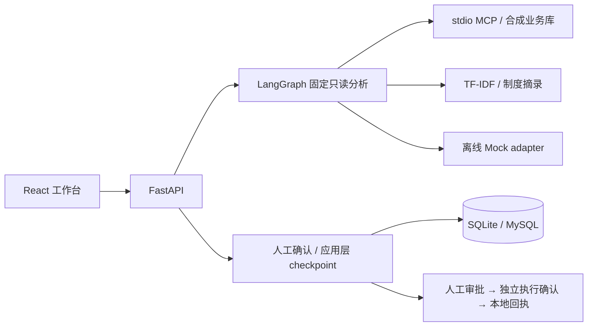

# ProcurePilot

采购 / 供应链异常协同本地原型：查清订单缺货与延期事实，附上制度摘录，经人工审批和独立执行确认生成本地 Mock 回执。

**状态：Stage 0～8 主线切片已实现，公开发布候选。** 使用合成数据、离线 Mock adapter 和本地 Mock 执行；尚未接入真实模型或生产 ERP。

## 演示故事

合成订单 `PO-2026-10086` 需求 100、可用库存 22，代码计算缺口 78、延期 2 天。只读分析展示事实、工具记录和制度引用；人工确认草稿并提交审批。批准后仍等待单独执行确认，执行后只保存本地回执。拒绝路径不生成回执。

## 已实现

- FastAPI / Pydantic / SQLAlchemy 后端、MySQL 配置与 SQLite 演示，React / TypeScript / Ant Design 工作台。
- LangGraph 七节点固定只读分析，通过真实 stdio MCP 查询本地合成订单、库存和供应商。
- TF-IDF 制度检索和原文摘录，引用带来源快照、行号与 SHA-256。
- 人工审批与执行确认分离；应用层事务 checkpoint、工作流创建幂等键、租约与人工恢复。
- 固定合成任务评测和浏览器内报告导入，展示失败检查与适用指标分母。

## 架构



## 验证

2026-10-15 在 Windows / 隔离 SQLite 上复验：116 项后端测试、17/17 固定 Mock 任务、独立 API 重启恢复及 11 项只读浏览器检查通过；前端构建通过并保留体积警告。结果绑定源码清单哈希，详见下方验证记录。

## 快速体验

已有锁定依赖时，从项目根目录执行：

```powershell
./.venv/Scripts/python.exe scripts/run_evals.py --confirm
```

它创建独立合成 SQLite 库与制度索引，启动自有 API、调用真实 stdio MCP 并实际重启 API，最后输出报告路径；不需要 Docker、API Key 或付费模型。首次安装需要网络。

- [安装与前后端启动](docs/QUICKSTART.md) · [5 分钟演示](docs/DEMO_SCRIPT.md)
- [当前验证记录与源码哈希](docs/VERIFICATION.md) · [可导入的本次评测报告](docs/evidence/report.json)
- [架构与恢复边界](docs/ARCHITECTURE.md) · [工程取舍与限制](docs/KNOWN_LIMITATIONS.md)
- [贡献与 AI 辅助说明](docs/CONTRIBUTIONS.md) · [数据与许可](docs/DATA_AND_LICENSE.md)

验证范围是固定合成 Mock 工作流，不能解释为模型准确率、生产权限认证、客户上线或实际降本收益。应用层 checkpoint 不等同于 LangGraph 原生 checkpointer，当前没有生产身份隔离或外部系统 exactly-once 保证。
