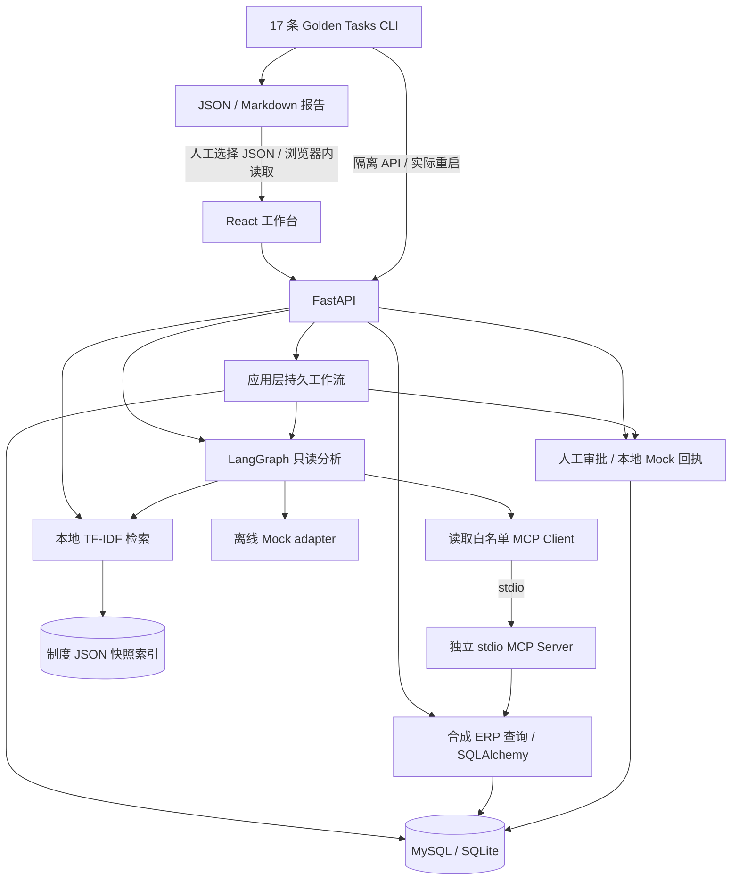
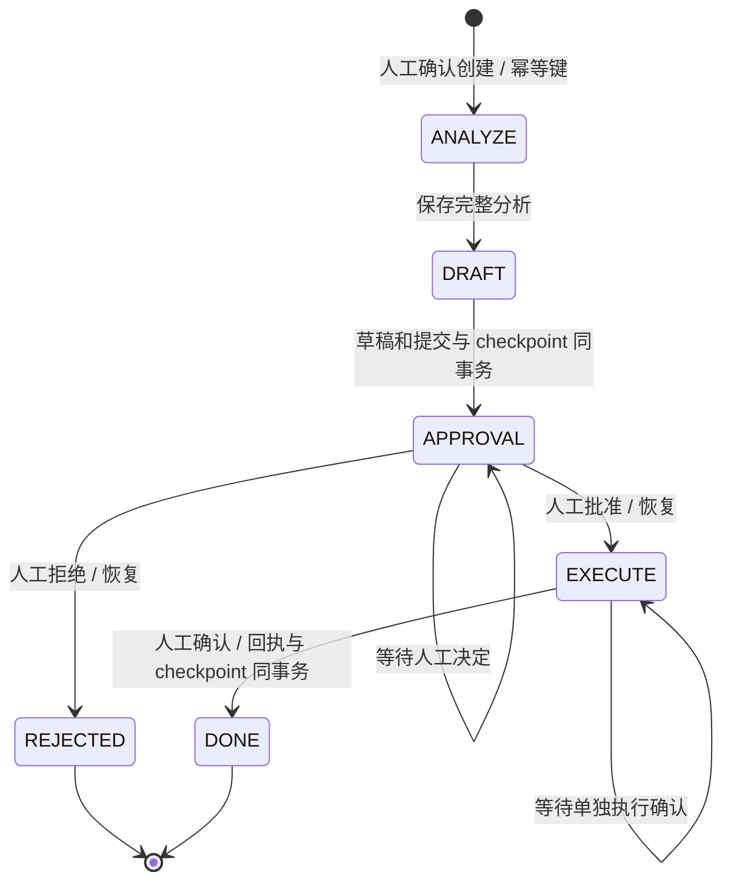

# 技术架构 — 已实现的 Stage 0～8

## 1. 运行路径

单体模块化，MCP 独立进程用于真实协议边界。未部署 Redis、向量数据库、消息队列或微服务。
评测创建独立 SQLite 和索引，不使用用户业务库；生产接入未实现。

## 2. 分析与确定性计算

`app/agent.py` 定义 identify_order → query_order → query_inventory → query_supplier → retrieve_policy → reason → final_response。
State 含 run_id、query、order_id、facts、policy、trace、tool_calls、status、final_answer。
库存缺口、延期和金额由代码计算，Mock adapter 整理事实与原文摘录，工具调用顺序固定。
读取有界重试、单次 / 总等待超时，失败保留已取得的事实并停止下游。独立 /agent/analyze 不保存历史。

## 3. 工具边界

Agent 的 MCP 客户端只允许 get_purchase_order、get_inventory、get_supplier。
Server 另外提供严格确认的 create_purchase_request_draft，但不在 Agent 白名单中，直接草稿入口没有创建幂等键。
MCP 是真实官方 stdio 协议；数据源是合成数据库，没有远程生产 ERP。
制度读取是本地函数，不经 MCP。用户问题不能将写工具加入客户端权限。

## 4. RAG 与引用

Markdown → 章节 chunk → 字符 n-gram TF-IDF → 余弦检索 → 原文摘录。
JSON 索引保存源快照、行号、来源哈希和向量，采用原子替换；检索不依赖预训练语义 Embedding 或生成式 LLM。
引用对应导入快照，不保证磁盘制度更新后索引自动更新；需显式重新导入。

## 5. 审批、事务与恢复

workflow_runs / workflow_checkpoints 存完整分析和业务下一阶段。已保存分析、已提交草稿不重做；分析保存前崩溃可能重新做只读分析。
这是应用层 checkpoint，不是 LangGraph BaseCheckpointSaver / 原生 interrupt / Command。
同键同输入返回已有运行，同键不同输入 409；60 秒租约和 owner_token 防止并发或过期进程提交。
事务失败回滚；提交后响应不确定先查原 ID / 原键。硬崩溃可能等待租约过期后人工恢复，无自动恢复 worker。
审批条件更新与审计同事务，本地 Mock 回执唯一；批准不自动执行，拒绝是终态。
没有真实支付、库存变更、外部补偿或分布式 exactly-once。actor 是人工标签，不是生产鉴权。

## 6. 评测与展示

17 条固定任务调用隔离 API / 真实 MCP；恢复任务实际停止并重启 API。
report.json / report.md 保存期望、检查、分子 / 分母、环境、fixture 哈希和逐任务响应路径。
适用失败算失败，不适用排除；业务效果检查覆盖申请 / Mock 回执差值和库存、订单不变。
UI Evaluation 只读取用户选择的报告，限制 2 MB，验证格式、计数与任务成功汇总；不上传、不执行报告内容、不独立认证真实性。
固定 Mock 任务得分不能推断真实 LLM 自主规划质量或生产安全。

## 7. 可观察性与数据

分析响应有 trace、工具参数、通道、尝试、耗时与证据；持久工作流保存分析、checkpoint、审批审计和回执。
评测报告保存逐任务验证证据，未接入 OTel / Langfuse / 外部日志服务。
全部合成数据；PO-2026-10086 需求 100、可用 22、缺口 78，延期 2 天。正常订单 PO-2026-10087 缺口 0、延期 0。
